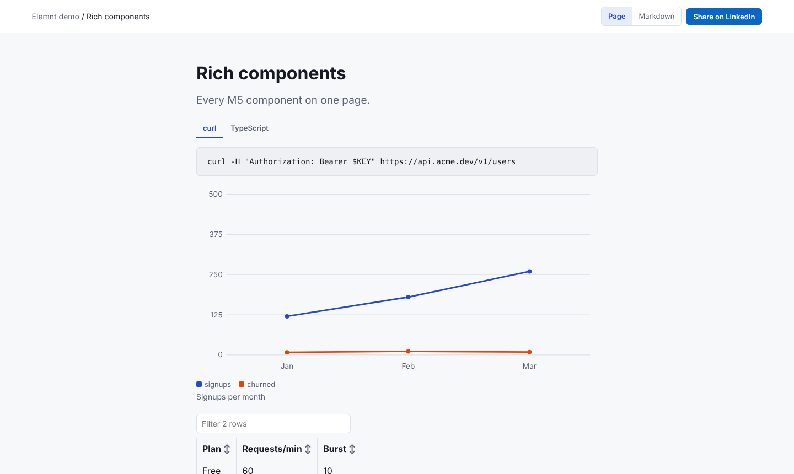
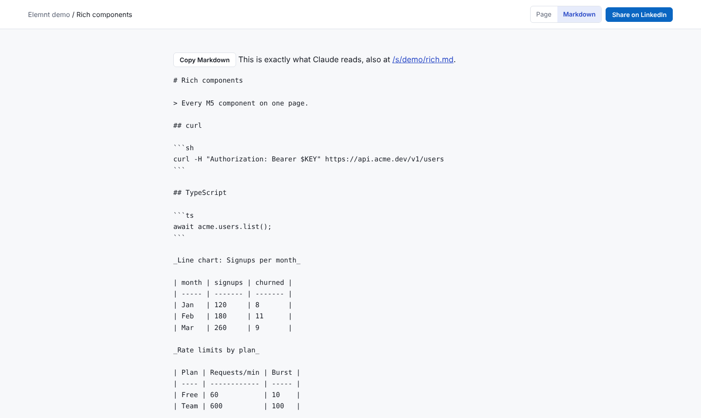
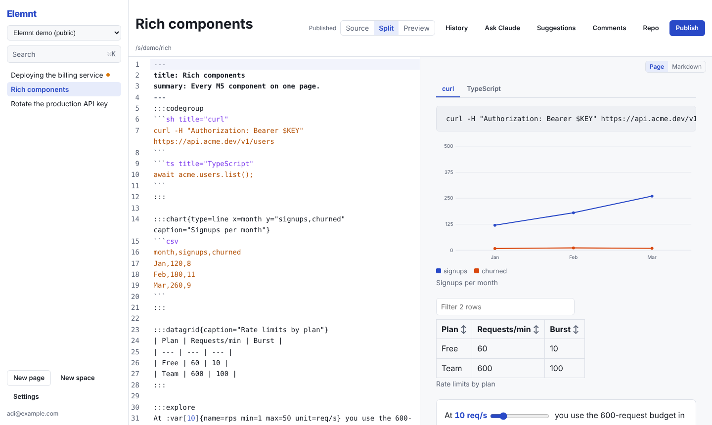
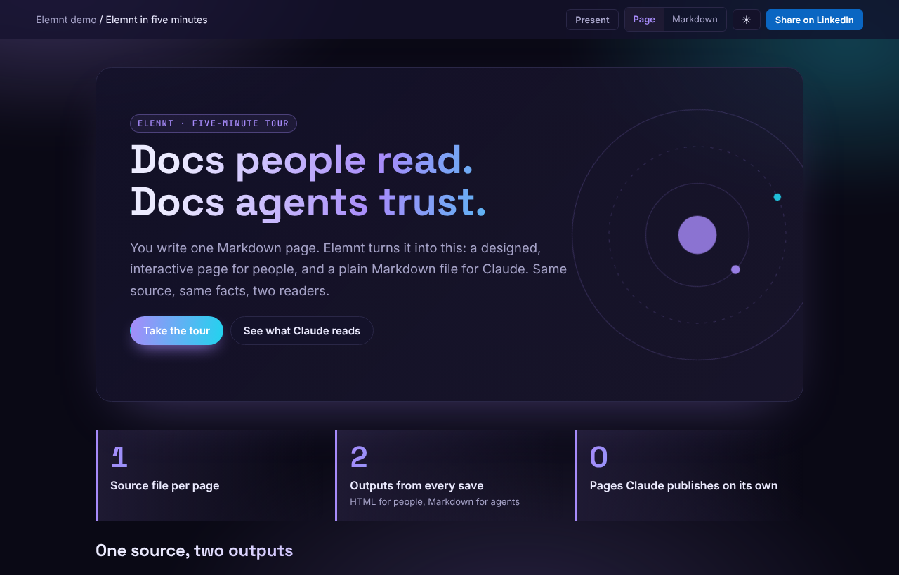
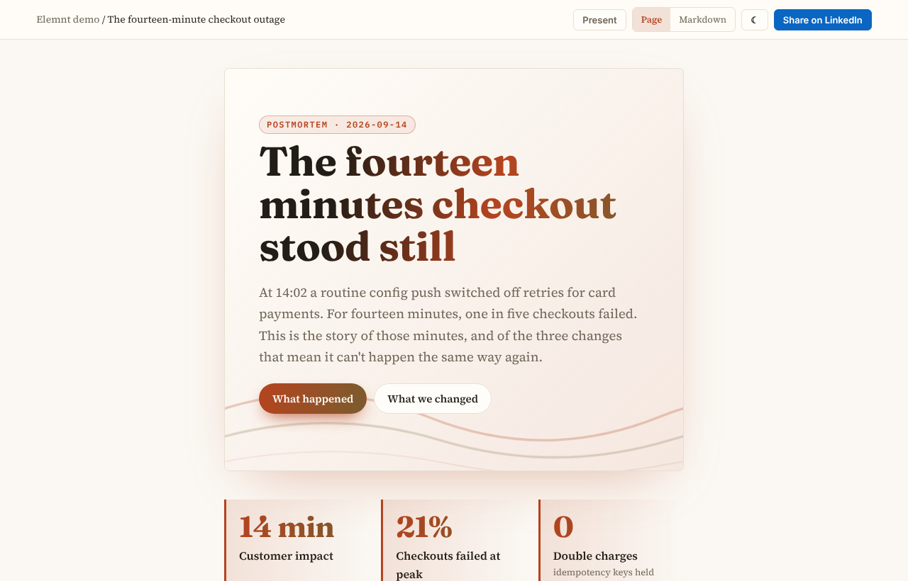
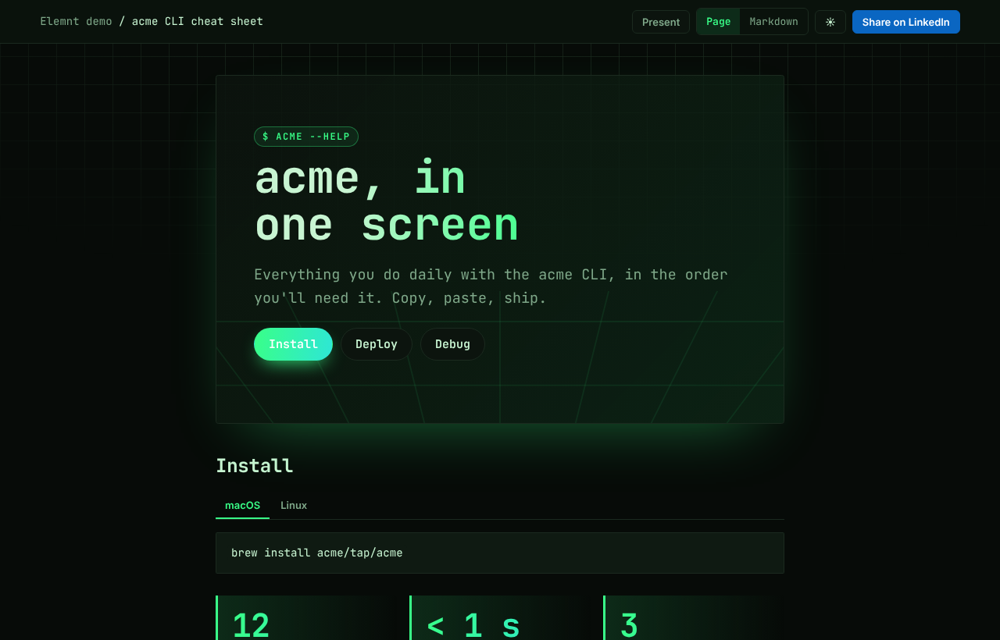
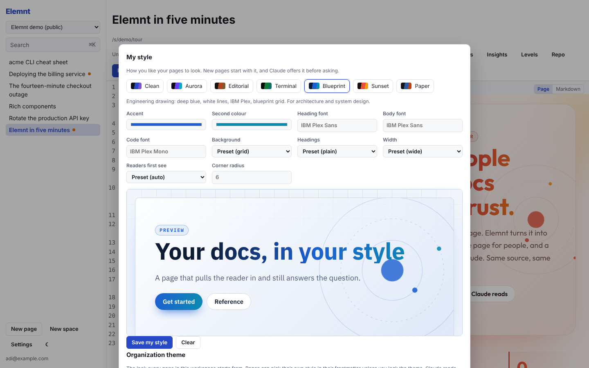
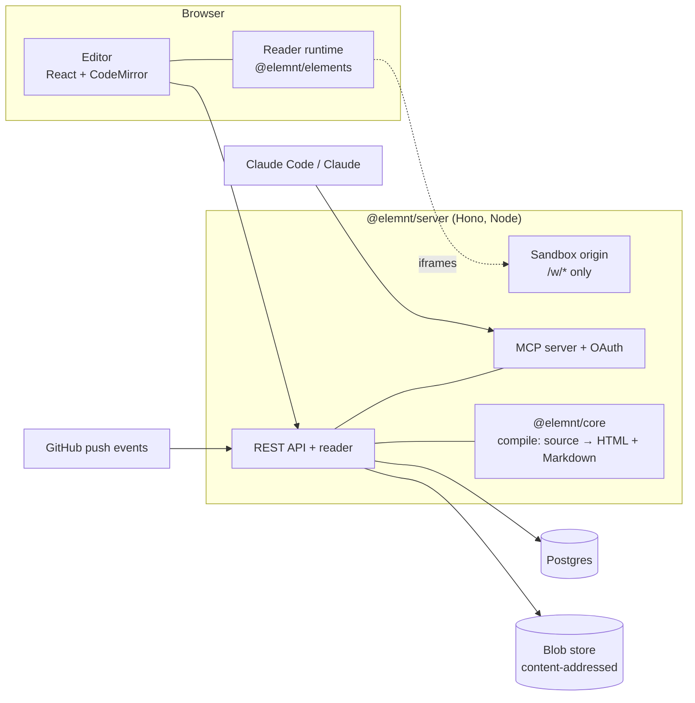

# Elemnt

**Docs written once, read two ways: as rich, interactive pages for people, and as clean Markdown for AI agents.**

Elemnt is a self-hostable documentation platform built for teams that work with AI. You write a page in Markdown with a few component blocks. Elemnt publishes it two ways from the same source: as an interactive page for your readers (charts, sliders, quizzes, runnable code, diagrams), and as plain Markdown for Claude and other agents. Claude can read your docs, draft new pages and suggest edits, but nothing goes live until a person approves it.



## The problem

Documentation is caught between two audiences that want opposite things.

- **People** learn from rich pages: a diagram, a slider that shows how a number changes, a quiz, a "run this" button. Markdown files in a repo rarely get any of that. The docs sites that can (Docusaurus, Mintlify, custom MDX) turn every page into a small front-end project.
- **Agents** need plain, predictable text. Rendered HTML, JSX, and pages that only make sense once JavaScript runs all trip them up. A growing share of your docs' readers are Claude Code, Claude and other assistants answering questions about your system.
- **Docs rot.** The code changes and nobody updates the page. AI can help write and maintain docs, but letting it publish unchecked just produces wrong docs faster.

Teams end up with a polished site they can't feed to an agent, or a Markdown folder nobody enjoys reading. Often they have both, drifting apart.

## How Elemnt solves it

**One source, two outputs.** Each page is Markdown plus directive components such as `:::callout`, `:::steps`, `:::chart` or `:::quiz`. Every save compiles it into two stored versions:

| For people | For agents |
| --- | --- |
| Interactive HTML: tabs, charts, sortable tables, sliders with live numbers, quizzes, annotated code, runnable JS and Python, Mermaid diagrams, sandboxed custom widgets | Plain Markdown where every component becomes text: a chart becomes a table, a quiz becomes a question with its answer, a widget becomes its description |

Readers switch between the two with a **Page / Markdown** toggle, so you always see exactly what Claude reads. The Markdown is also served at `page.md`, through `llms.txt`, and over MCP.



**AI writes drafts, people publish.** Elemnt is an MCP server. Claude Code or Claude can search your docs, read pages, learn the component syntax and write back. Writes come in only as **drafts** (new pages) and **suggestions** (edits to existing pages). You review each suggestion hunk by hunk in the editor and accept what's right.

**Docs that keep up with the code.** Link a page to a GitHub repo at the commit it describes. When files the page cites change, Elemnt opens a suggested update on the page, written by Claude if you've added a key. The page shows "written against `a1b2c3d`, 4 commits behind". Elemnt only reads the repo and never writes back to it.

**Docs live in Elemnt, not in your repo.** Your repo keeps a short README with a badge linking to its explainer page. No generated doc files, and no docs PRs to review.



## Docs that look like a designed web page

A docs page should pull the reader in, not just sit there. Every Elemnt page can have its own look, set in its frontmatter, and readers can switch light and dark mode on any page.

```yaml
---
title: Payments, explained
style:
  preset: aurora            # clean, aurora, editorial, terminal, blueprint, sunset, paper
  headingFont: Space Grotesk  # any Google Fonts family
  accent: "#7c3aed"
---
```

| Aurora | Editorial | Terminal |
| --- | --- | --- |
|  |  |  |

- **Layout components** made for that: `:::hero` with background art and call-to-action buttons, `::::cards`, `:::stats` big numbers, `::::timeline`, full-width `:::band`s, `:badge`s and `:::quote`s.
- **Inline SVG graphics** with `:::graphic`, animated with SMIL if you like, drawn right in the page in the page's colours. They're checked against an allowlist: no script, no external URLs. For anything more custom, a `:::widget` with only HTML and CSS runs in the sandbox without a click.
- **Your organization's theme.** Admins set a preset, colours, fonts, notes on voice and tone, and optional CSS for the whole workspace, and can lock it so every page stays on brand. The workspace's saved components show up in the `/` menu and for Claude.
- **Your own style.** Each person saves the style they like; new pages start with it.
- **Claude asks before it styles.** Over MCP, Claude calls `get_style_guide` before it writes. If your organization's theme is locked it follows it. Otherwise it asks you which style and fonts you'd like (or uses your saved one), then writes an eye-catching page that still reads clearly. The `elemnt-docs-style` skill in [integrations/claude-code](integrations/claude-code) spells this out.

Agents still get plain Markdown: a hero becomes a heading and a paragraph, cards become sections, a graphic becomes its alt text.



## What you can do with it

- **A rich explainer for any repo.** One page per project, linked from the README with a badge and kept current by the drift check. It has an architecture diagram, a quickstart, a tour of the code and a live demo. Claude Code writes it with the bundled `repo-explainer` skill.
- **Team docs that replace a wiki.** Spaces (private, workspace or public), a page tree, full-text search, comments anchored to quotes, and version history with restore.
- **"Generate docs" from Claude Code.** Say "document the billing service". Claude reads the code, writes the page, validates it and gives you the review link.
- **Runbooks Claude can run.** People read `::::runbook` steps as a normal page. Agents get them as structured steps with approval gates and expected output.
- **Interactive explanations.**
  - `:var` sliders feed `:calc` values, as in "at **30 req/s** you hit the limit in **20 s**".
  - Charts from CSV, quizzes, before/after comparisons and glossary terms.
- **Your own components.** `:::widget` runs your HTML, CSS and JS in a locked-down sandbox on a separate origin, with abuse protections (see below).
- **Share publicly.** Public pages get:
  - Open Graph previews and a LinkedIn share button
  - optional posting to LinkedIn from Elemnt
  - view counts by source

## Quick start (self-host with Docker)

You need Docker and `openssl`.

```sh
git clone https://github.com/ar-0911/elemnt.git && cd elemnt
cp .env.example .env
echo "ELEMNT_SECRET_KEY=$(openssl rand -base64 32)" >> .env
docker compose up -d
docker compose exec server node dist/bootstrap.js --email you@example.com   # prints your API token
docker compose exec server node dist/seed-demo.js                            # optional sample pages
```

Then:

1. Open http://localhost:8787/login and paste the token.
2. Go to http://localhost:8787/app for the editor.

To use Claude features, add an Anthropic API key under **Settings** in the editor. Each workspace brings its own key. To connect Claude Code to your docs:

```sh
claude mcp add --transport http elemnt http://localhost:8787/mcp
```

[integrations/claude-code](integrations/claude-code) covers the MCP tools and the `generate-docs` and `repo-explainer` skills.

## Writing a page

```md
---
title: Rate limits
summary: How many requests you can make, and what happens when you go over.
---

:::callout{type=warn}
Limits are per API key, not per account.
:::

At :var[10]{name=rps min=1 max=50 unit=req/s} you use the 600-request
budget in :calc{expr="600/rps" digits=0 unit=s}.

:::quiz[You send 11 requests per second on the Free plan. What happens?]
- [ ] Requests queue until capacity frees up
- [x] Requests beyond the limit get a 429 with Retry-After
:::
```

The editor reports errors in component blocks with line numbers, and a page with errors can't be published. Type `/` in the editor to insert any component. Agents get the same catalog from the MCP tool `get_authoring_guide`.

## Safety model

- **AI never publishes.** Agent writes are drafts or suggestions. Accepting a suggestion produces a draft, and a person publishes it.
- **Bring your own key.** Anthropic keys are encrypted at rest (AES-256-GCM) and never sent back to the browser.
- **No untrusted HTML in pages.** Raw HTML in Markdown is dropped, and the compiled output is sanitized against an allowlist. Inline SVG graphics go through a stricter SVG allowlist. Page styles are data (hex colours, font names, enum values), never CSS; only workspace admins can add CSS, and it can't import or load remote URLs.
- **Custom code runs in a sandbox.** Widgets and runnable code are served from a separate origin and framed with `sandbox="allow-scripts"` only. Their CSP blocks network, eval, WebAssembly, workers and forms. On top of that:
  - a label the widget can't cover
  - click-to-run on public pages of unverified workspaces
  - a watchdog that stops runaway frames
  - a confirmation before any link leaves the page
  - a scan on save that refuses miners, password fields and obfuscated code
  - a report button, and a kill switch that disables a widget everywhere at once
- **Repos are read-only.** The GitHub integration only reads. Drift fixes land as suggestions in Elemnt.

## How it's built



| Package | What it does |
| --- | --- |
| [`@elemnt/core`](packages/core) | Parser, component contract, validation, the HTML and agent-Markdown compilers, and the built-in components. No DOM, so it runs in Node, workers and the browser |
| [`@elemnt/elements`](packages/elements) | Vanilla browser runtime (about 7 KB gzipped) that hydrates rendered pages: charts, sliders, quizzes, the widget sandbox host, runnable code |
| [`@elemnt/server`](apps/server) | API, reader, search, comments, MCP server with OAuth, Claude suggestions, repo drift checks, LinkedIn. Postgres through Drizzle |
| [`@elemnt/web`](apps/web) | The split-view editor: live preview compiled in a worker, drafts, history, suggestion review, comments, ⌘K search, ⌘I "Ask Claude" |

Every revision stores three content-addressed bodies: the source, the HTML and the Markdown.

## Develop

Requires Node 22+ and pnpm 10.

```sh
pnpm install
pnpm build
pnpm test        # Vitest; the server tests run against in-process Postgres (PGlite)
pnpm typecheck
```

Requires Node 22+ and pnpm 10.

## Debugging

[`docs/field-guide.html`](docs/field-guide.html) maps the codebase (every package and file), traces how saves, reads, ⌘I and MCP requests flow through it, and gives a routine for when something breaks: health check, where the logs are, error codes, known weak spots and how to target tests. Open it in a browser after cloning. It was written against `feat/m7-deploy`, so it also covers the code in PRs #9–#11.
For hot reload:

1. Set `DATABASE_URL` and `ELEMNT_SECRET_KEY`, then run the server with `pnpm --filter @elemnt/server dev`.
2. Run the editor with `pnpm --filter @elemnt/web dev`.
3. Open http://localhost:5173/app/.

[apps/server/README.md](apps/server/README.md) documents the server routes and configuration.

## Status

Elemnt is early. It runs as a single Node server with Postgres, packaged for Docker, with deploy targets for [Cloudflare Containers + R2](deploy/cloudflare/README.md) and [AWS App Runner + RDS + S3](deploy/aws/README.md). Both targets are new and not yet proven in production. Expect breaking changes before 1.0.
