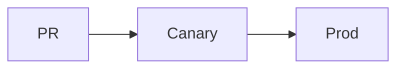

## Before you start

:::callout[Production access]{type=warn}
You need the `deployer` role. Ask in #platform if you don't have it.
:::

Meetings start at 10:30 and the ratio:high flag stays literal.

## Install

::::tabs
:::tab[npm]
```sh
npm i -g @acme/deploy
```
:::
:::tab[pnpm]
```sh
pnpm add -g @acme/deploy
```
:::
::::

## Ship it

:::steps
1. **Tag** the release with `acme tag`.
2. **Watch** the canary dashboard for 10 minutes.
3. **Promote** with `acme promote`.
:::

:::diagram{caption="Release path"}

:::

:::details[Why canaries?]
A canary takes 5% of traffic, so a bad release hurts few users.
:::

| Env | Region |
| --- | ------ |
| prod | eu-west-1 |
