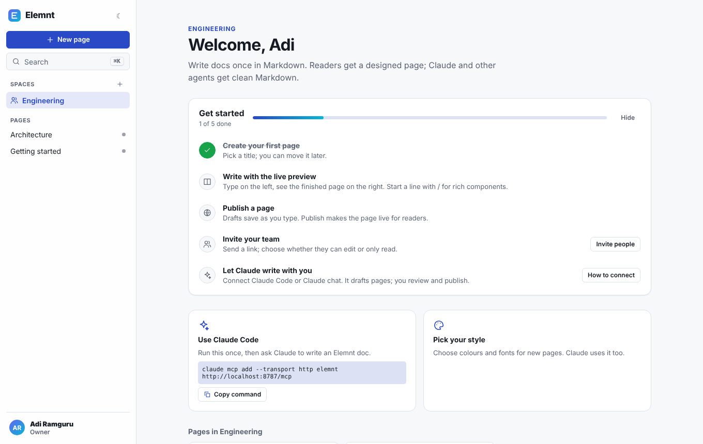
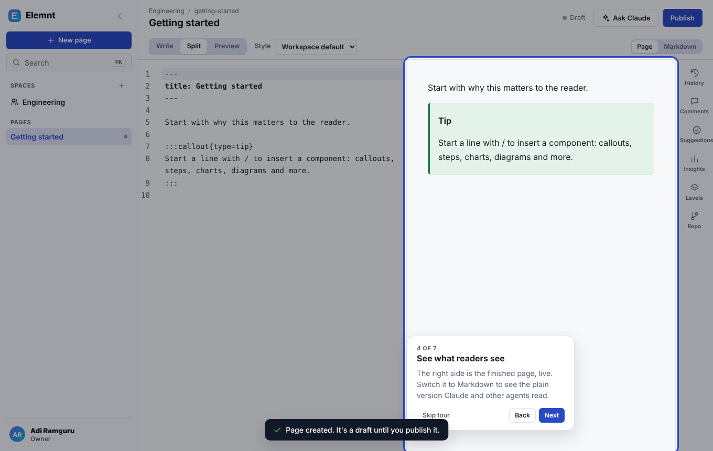
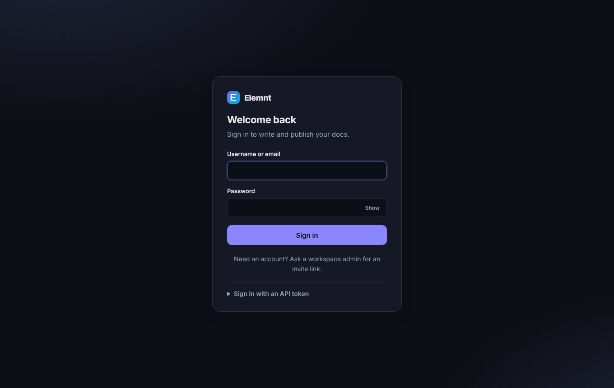
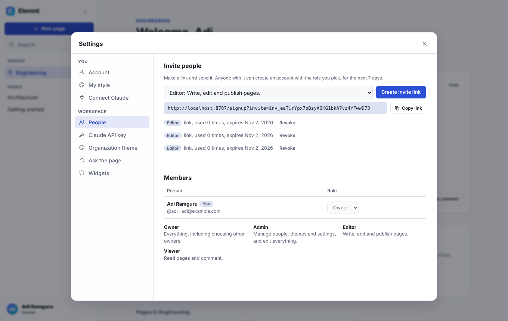

# UX principles

These are the rules the Elemnt editor follows. Use them when you add a screen or a control, and when you review someone else's.

## 1. One obvious next step

Every area has one primary button, and it says what it does: **New page** in the sidebar, **Publish** in the page header, **Create workspace** on the first sign-up. Everything else is a secondary or ghost button. If two things compete for attention, one of them moves into a menu or the side rail.

## 2. Show tools when they're needed, not all the time

The editor shows the text and the preview. History, comments, suggestions, insights, reading levels and the repo link live in the side rail and open one at a time. Rarely used settings sit in Settings, grouped as **You** (account, style, connecting Claude) and **Workspace** (people, API key, theme, ask, widgets). Viewers don't see controls they can't use.

## 3. Teach in place, once

New people get three kinds of help, and none of them gets in the way twice:

- A **Get started** checklist on the welcome page. Each item is a real action with a button that does it. Items tick themselves off when the work is done (a page exists, a page is published), and the whole list can be hidden.
- A **guided tour** the first time someone opens a page: seven short tips pointing at the real controls. Arrow keys move through it, Esc ends it, and **Take the tour** in the account menu replays it.
- **Inline hints** next to fields that need them ("3 to 30 letters, digits, - or _"), not a manual.

## 4. Always say what state things are in

The page header shows one status: Saving, Unsaved, Draft, Unpublished changes or Published. The sidebar puts a dot next to pages with changes readers haven't seen. Actions confirm with a short toast ("Page created. It's a draft until you publish it."). Errors say what went wrong and what to do, next to the field that caused them.

## 5. Plain words

Labels use the reader's words: "Invite people", "Connect Claude", "Sign in with an API token". No ids, no jargon, no exclamation marks. Destructive actions name what they remove ("Remove Adi from this workspace? They'll be signed out.").

## 6. Forgiving by default

Drafts save as you type, and publishing is a separate, deliberate step. Every revision is kept in History. Claude's edits arrive as suggestions you accept piece by piece. Invite links expire after 7 days and can be revoked. Owners can't remove the last owner.

## 7. Keyboard first, mouse friendly

⌘K (Ctrl K) opens search and jump-to-page. ⌘I asks Claude about the selection. **?** lists every shortcut. Dialogs trap focus, close on Esc and return focus where it was. Menus work with the arrow keys.

## 8. Accessible to everyone

- Text and controls meet WCAG AA contrast in light and dark mode.
- Every icon-only button has a label; focus rings are always visible.
- Motion is short and is turned off when the system asks for reduced motion.
- Hit targets are at least 32px, and the layout stacks below 900px wide.

## 9. Calm, consistent visuals

One set of design tokens drives the editor (`apps/web/src/app.css`): a neutral surface, one accent colour, an 8px spacing grid, three radii and two text sizes per level. The editor stays quiet so the page you're writing is the colourful thing on screen. Published pages get their look from the author's style and the workspace theme, not from the editor.

## 10. Accounts that just work

The first person to open a fresh install creates the workspace on a single form. Later people sign in with their username or email and a password, or join through an invite link that already carries their role. API tokens are still there for scripts and CI, under Settings → Account, where they can be revoked.

## Checklist for a new screen

- [ ] Is there exactly one primary action?
- [ ] Could a first-time user tell what this screen is for from its heading and one line?
- [ ] Does every action give feedback (toast, status or inline error)?
- [ ] Can it be undone, or does it ask first?
- [ ] Does it work with the keyboard alone, in dark mode, and at 390px wide?
- [ ] Does a viewer see only what they can use?
